# Screenshots · 软件预览 · プレビュー

[README (English)](../readme.md) | [README（简体中文）](./readme/readme_zh.md) | [README（日本語）](./readme/readme_ja.md)

All screenshots use the English interface with made-up sample data from the offline demo (`pixi run demo`); the covers are generated placeholder art. 
截图均为英文界面，数据来自离线演示模式的虚构示例，封面是生成的占位图。 
スクリーンショットは英語 UI で、オフラインのデモモードの架空のデータを使っています。カバーは生成したプレースホルダー画像です。

## Home · 首页 · ホーム

Rows of your subscriptions, hot lists, tags or keywords, each with its own tabs and refresh. 
可自定义的栏目：我的订阅、热门、任意标签或关键词，每栏各自切换与刷新。 
購読・人気・任意のタグやキーワードの欄を並べ、欄ごとに切り替えと更新ができます。

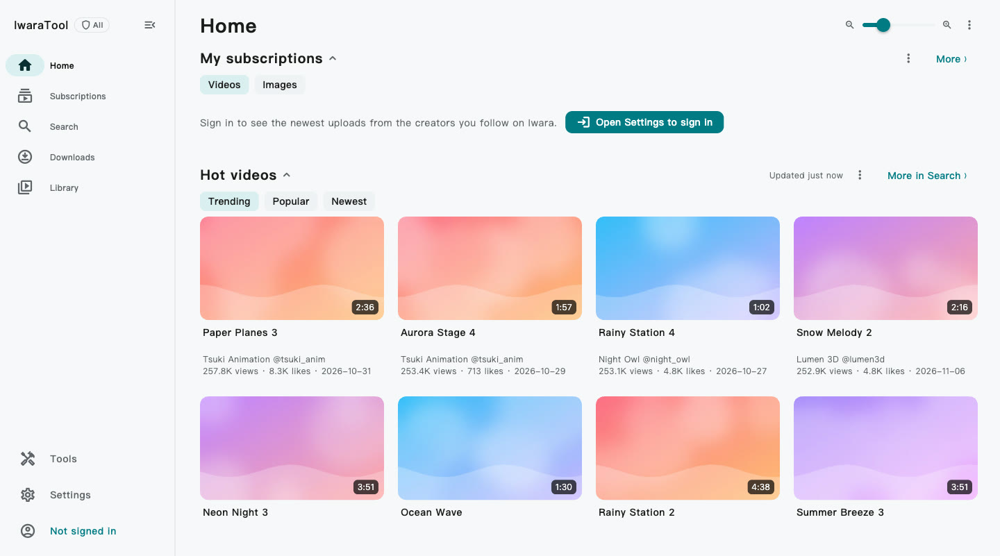

## Search · 搜索 · 検索

Iwara and Oreno3D, scopes, sorting, post-search filters and download marks. 
Iwara 与 Oreno3D、搜索范围、排序、搜索后筛选与下载标记。 
Iwara と Oreno3D、検索範囲、並び順、検索後の絞り込み、ダウンロードの印。

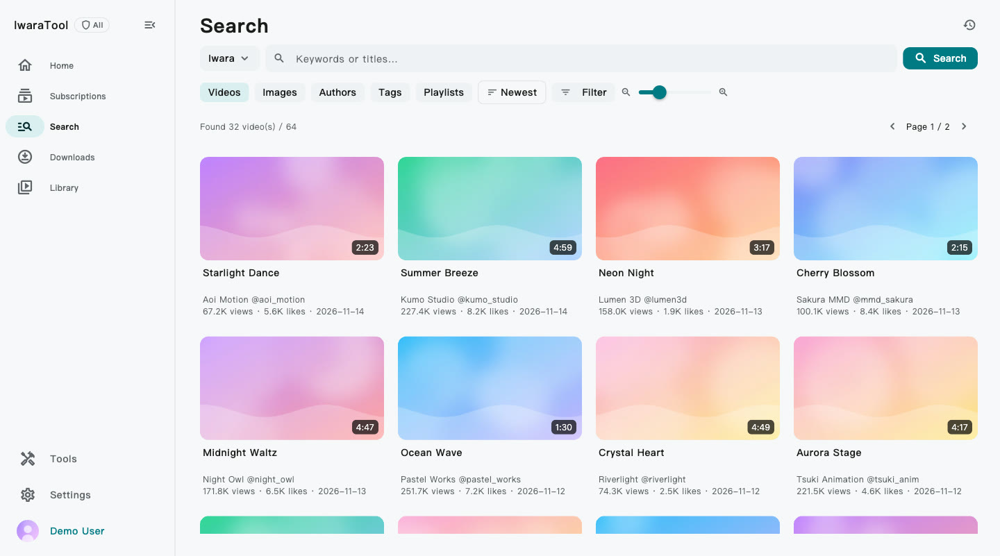

## Video details · 视频详情 · 動画の詳細

The built-in player, likes, the author card, tags, related posts and comments. 
内置播放器、点赞、作者卡、标签、相关推荐与评论。 
内蔵プレイヤー、いいね、作者カード、タグ、関連投稿、コメント。

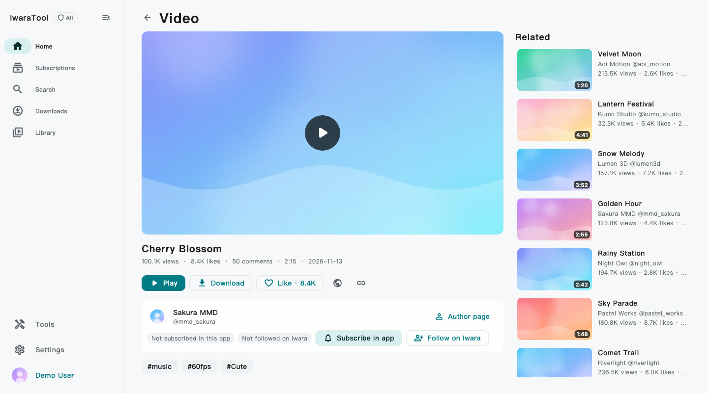

## Downloads · 下载 · ダウンロード

Paste links, confirm in the download sheet, follow progress by state. 
粘贴链接，在下载面板确认，按状态查看进度。 
URL を貼り付けてパネルで確認し、状態ごとに進捗を確認します。

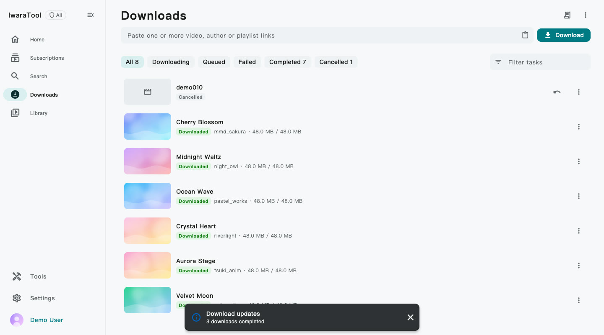

## Subscriptions · 订阅 · 購読

Authors and playlists on the left, the chosen one's works on the right. 
左侧是作者与播放列表，右侧是所选订阅的作品。 
左に作者とプレイリスト、右に選んだ購読の作品。

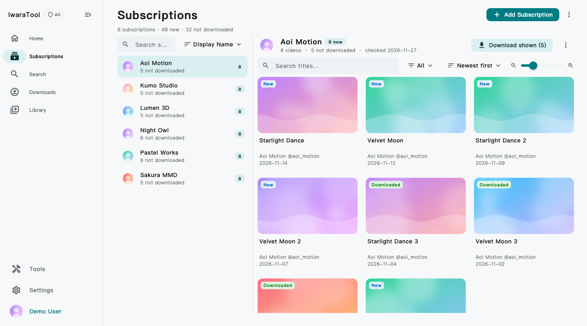

## Library · 资料库 · ライブラリ

Every download with filters, NFO tags, previous / next and autoplay. 
所有已下载的视频，支持筛选、NFO 标签、上一个 / 下一个与自动连播。 
保存したすべての動画。絞り込み、NFO のタグ、前へ / 次へ、連続再生。

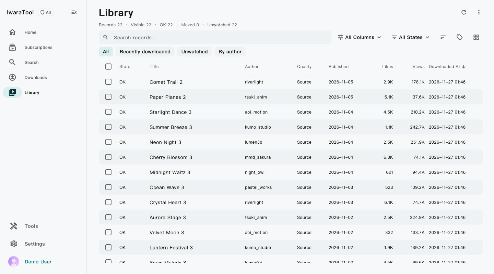

## Tools: download rules · 工具：下载规则 · ツール：ダウンロードルール

Filename template with a live sample, presets, fields and metadata filters. 
文件名模板实时预览、命名预设、插入字段与元数据筛选。 
ファイル名テンプレートのリアルタイム表示、プリセット、フィールドの挿入、メタデータの絞り込み。

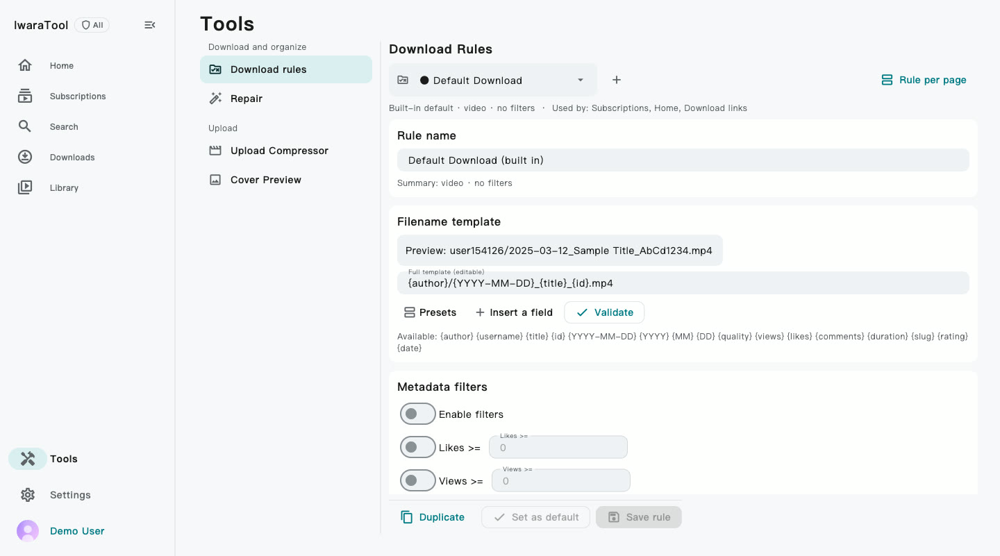

## Tools: cover preview · 工具：封面预览 · ツール：カバープレビュー

The 16 cover choices Iwara will offer after an upload. 
上传后 Iwara 会提供的 16 张封面候选。 
アップロード後に Iwara が示す 16 枚のカバー候補。

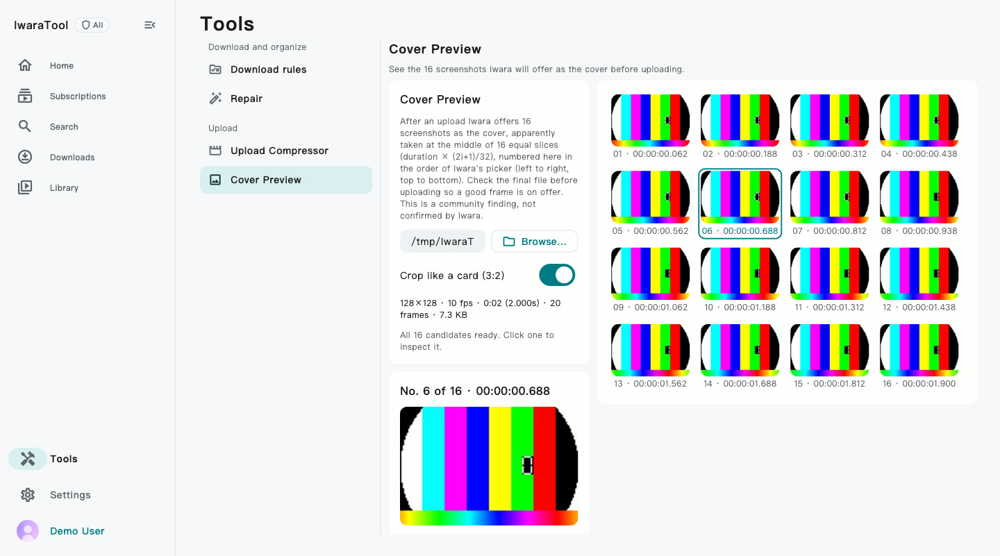

## Settings · 设置 · 設定

Groups by purpose; every change is saved at once. 
按用途分组，修改立即保存。 
用途別のグループ。変更はすぐ保存されます。

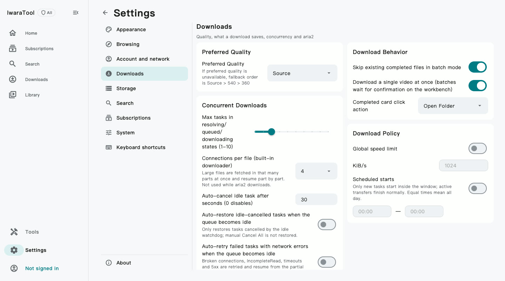

## Dark theme · 深色主题 · ダークテーマ

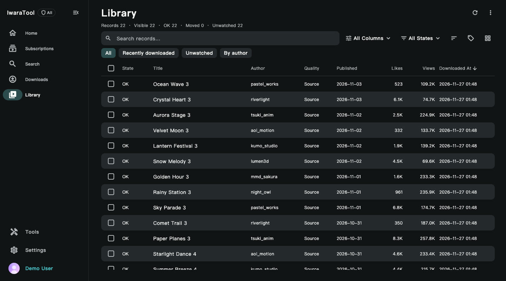

## Phone (Android) · 手机 · スマートフォン

Bottom bar and full-screen pages on a phone. 
手机上为底部导航栏与全屏页面。 
スマートフォンでは下部バーと全画面ページ。

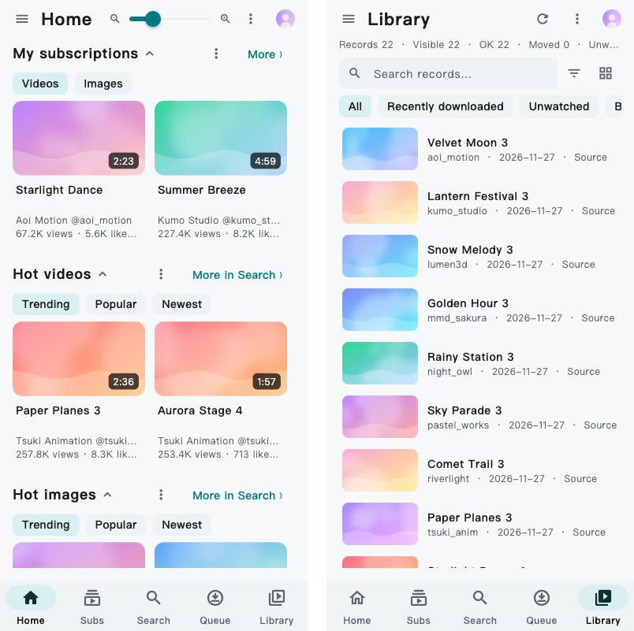
