# IwaraTool

[English](../../readme.md) | [简体中文](./readme_zh.md)

煩わしいコマンドラインにさよなら！Windows・macOS・Android に対応したモダンなインターフェースの Iwara 一括ダウンローダー。初心者でもワンクリックで作者の全動画をダウンロードできます。

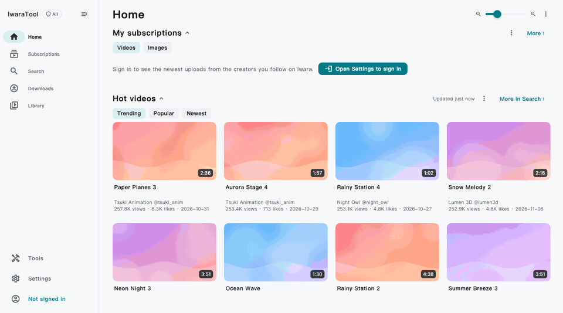

## できること

- **一括ダウンロード**：「ダウンロード」ページに作者・プレイリスト・検索・動画の URL を貼り付けるだけでまとめて保存。終わらなかったタスクは次回起動時に再開し、大きなファイルは複数接続で分割ダウンロードして部分ごとに再開します。
- **検索と閲覧**：Iwara と Oreno3D を検索でき、英中日のタグ候補にも対応。ホームには好きな欄（購読、人気、任意のタグやキーワード）を並べられます。保存済みの動画には印が付きます。
- **見てから保存**：カバーをクリックすると詳細ページを開き、内蔵プレイヤー・いいね・作者・タグ・関連投稿・コメントを確認できます。
- **iwara.tv と iwara.ai**：Ctrl+Shift+S で表示するサイトを切り替え。アカウントは共通で、貼り付けたリンクや購読はそれぞれのサイトで扱います。
- **作者をフォロー**：作者とプレイリストを購読し、新着をひと目で確認。新しい動画だけをダウンロードできます。
- **再生できるライブラリ**：保存した動画を表・リスト・カバーで表示し、絞り込み、NFO のタグ、前へ / 次へ、連続再生に対応。記録の削除は元に戻せます。
- **欲しいものだけ保存**：ルールで、いいね数・再生数・日付・タグ・タイトルのキーワードで絞り込め、ページごとにルールを記憶できます。
- **好みの名前で保存**：命名プリセットを選ぶかテンプレートを直接編集し、メニューからフィールドを挿入。結果のファイル名をリアルタイムで表示します。
- **NAS / サーバーへ保存**：NAS の aria2 にダウンロードを任せられます。ライブラリでは「リモート」と表示されローカルのファイルとは区別され、カバーはこの PC にキャッシュ。マウント先や HTTP アドレスを指定すれば再生できます。
- **既存ファイルを整理**：修復センターで、保存済みの動画をステップ形式でプレビューしながら一括リネーム・整理できます。
- **アップロードの準備**：アップロード圧縮で動画を Iwara の 300 / 600 MB 上限に収め（H.264 + AAC、MP4、720p 以上）、カバープレビューでアップロード後に選べる 16 枚の候補を事前に確認できます。ffmpeg が必要です。
- **どんなウィンドウにも**：広い画面はサイドバー、狭い画面とスマートフォンはドロワーと下部バー。中／英／日の言語、ライト／ダークテーマ、システム通知、Windows のトレイ / macOS の Dock への常駐、ログイン時の自動起動、バックアップ。
- **Android**：スマートフォンで閲覧・検索・購読・ダウンロード・再生。新しい APK はそのまま上書きインストールで更新できます。

## 画面紹介

スクリーンショットは英語 UI で、オフラインのデモモード（`pixi run start --demo`）の架空のデータを使っています。カバーは生成したプレースホルダー画像です。

1. ホーム

   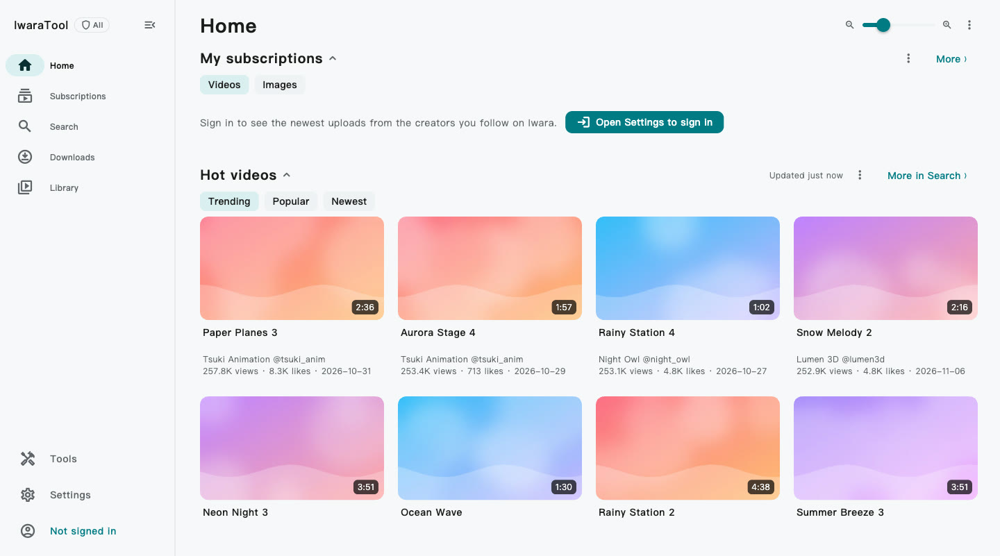
2. 検索

   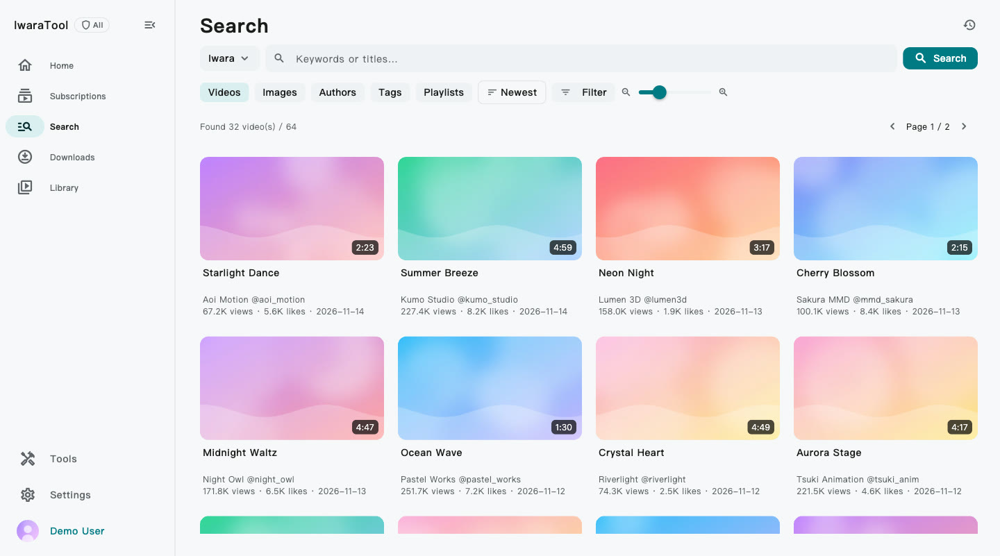
3. 動画の詳細と内蔵プレイヤー

   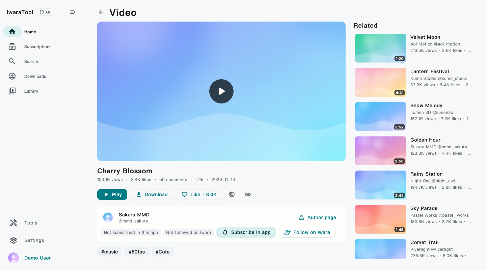
4. ダウンロード

   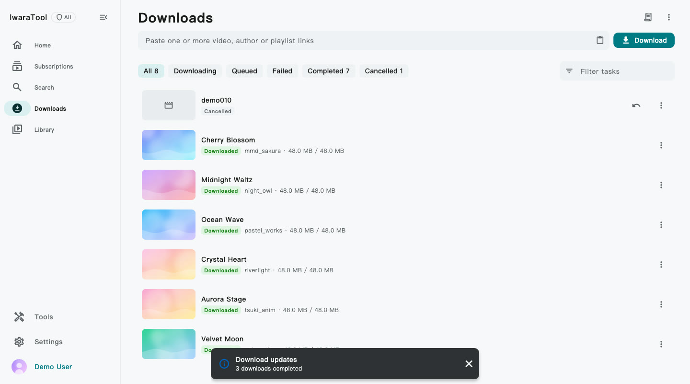
5. 購読

   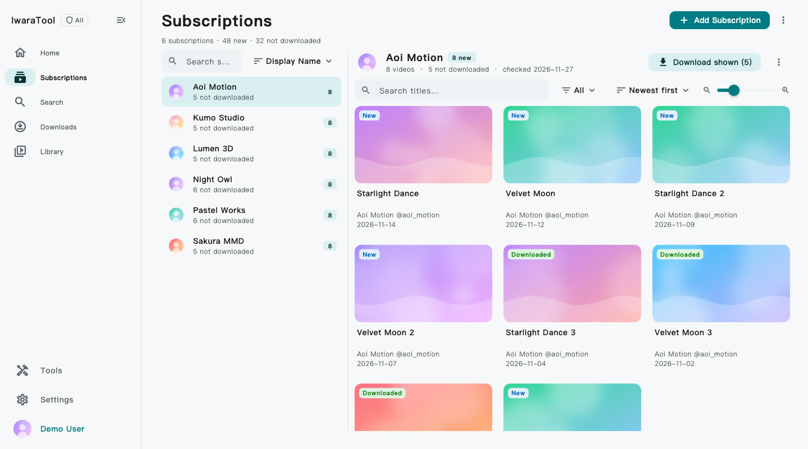
6. ライブラリ

   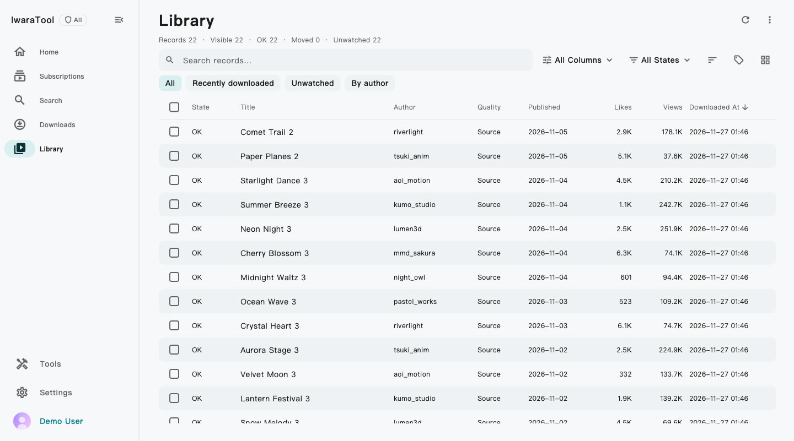
7. ツール：ダウンロードルール

   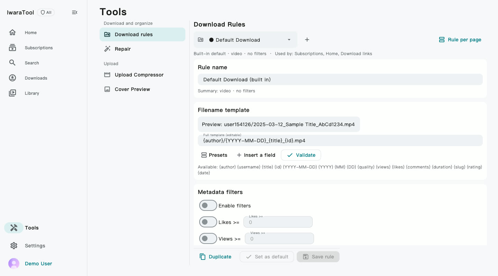
8. ツール：カバープレビュー

   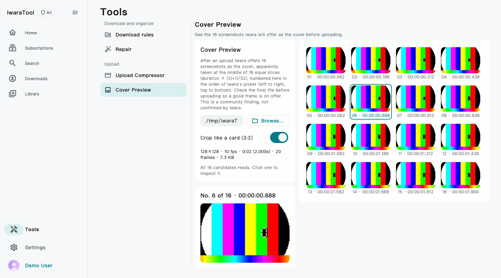
9. 設定

   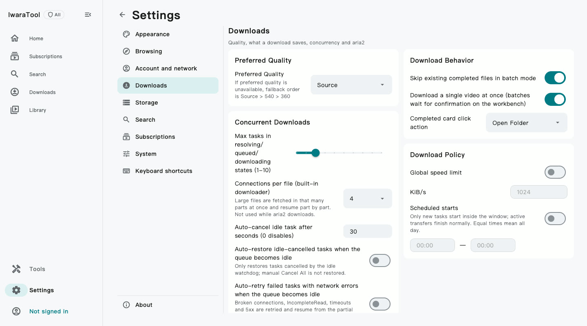
10. ダークテーマ

   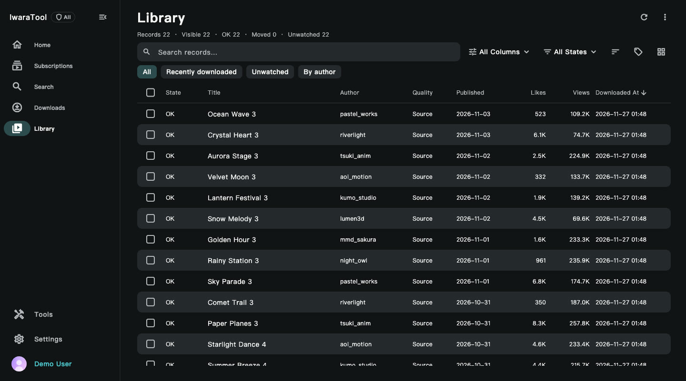
11. スマートフォン（Android）

   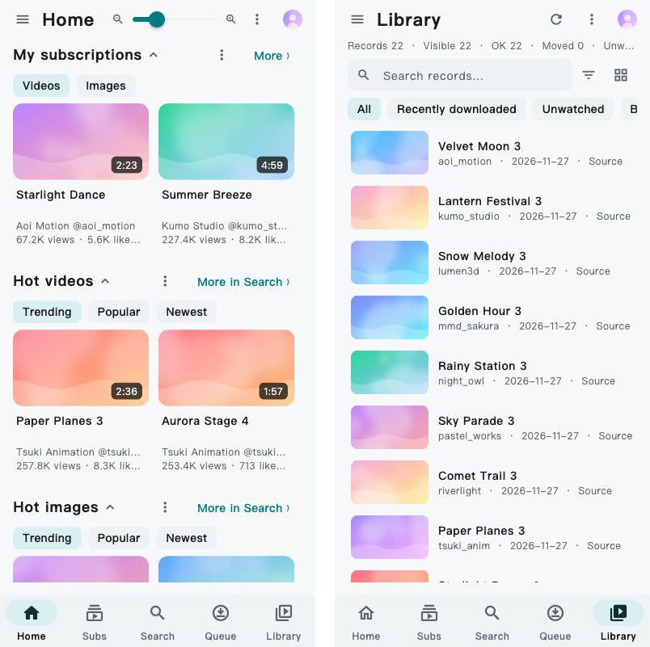

## クイックスタート

1. [Releases](https://github.com/Moeary/IwaraTool/releases) から最新版を取得して起動します。（ファイルの選び方、macOS の初回起動時の警告、プロキシ設定は [インストールと基本の使い方](../guide/install_ja.md) を参照。）
2. 非公開動画の保存やフォロー作者の取込には、サイドバー下部のアカウントからログインしてください。
3. `ダウンロード` ページに URL を貼り付けて「ダウンロード」を押すと、追加される内容と使うルールがパネルに表示されます。
4. `購読` で作者やプレイリストをフォローして新着を保存できます。保存した動画は `ライブラリ` で確認できます。

詳細：[インストール](../guide/install_ja.md) · [使用ガイド](../guide/usage_ja.md) · [リファレンス（対応 URL、命名プレースホルダー、ソースからのビルド）](../guide/reference_ja.md) · [ローカルデータとキャッシュ](../guide/data_ja.md) · [Wiki](https://github.com/Moeary/IwaraTool/wiki)

## 貢献

PRは大歓迎です！
変更は `dev` ブランチ向けに提出し、英語、簡体字中国語、日本語の UI 文言を同期してください。提出前にテスト一式を実行し（ビルドとテストのコマンドは [リファレンス](../guide/reference_ja.md#ソースから実行--ビルド) を参照）、UI の変更には可能であればスクリーンショットまたは短い録画を添付してください。

## コード署名ポリシー（Code signing policy）

リリースは GitHub Actions が本リポジトリからビルドします。新しい Windows ビルドの SignPath 署名は準備中で、有効になるとリリースを手動で承認してから署名します。Free code signing provided by [SignPath.io](https://about.signpath.io/), certificate by [SignPath Foundation](https://signpath.org/)。チームの役割とプライバシーポリシーは英語版の [Code signing policy](../../readme.md#code-signing-policy) を参照してください。

## ライセンス

MIT License。

**本プログラムをダウンロードした時点で、MIT ライセンスを遵守することに同意したものとみなされます。詳細は LICENSE ファイルを参照してください。**

1. 本プロジェクトを違法、公序良俗に反する目的、または法令に違反する目的で使用することを禁止します。違反した使用により生じた損害については、ユーザーが全責任を負うものとします。
2. 本プロジェクトで提供されるパッケージ版およびスクリプトは、個人の学習および研究目的のみに使用されるものであり、許可なく商用での再配布や転売を行うことはできません。
3. プロジェクトの管理者は、法令またはコミュニティのフィードバックに基づき、いつでもサービスおよびサポートを更新、中断、または終了する権利を留保します。

## 特別感謝

[hare1039](https://github.com/hare1039) 氏の [iwara-dl](https://github.com/hare1039/iwara-dl/tree/master) プロジェクトから貴重な参考とインスピレーションをいただきました。特に X-Version 署名計算とダウンロードリンク解析の実装詳細は、本プロジェクトの開発に大きな推進力となりました。
