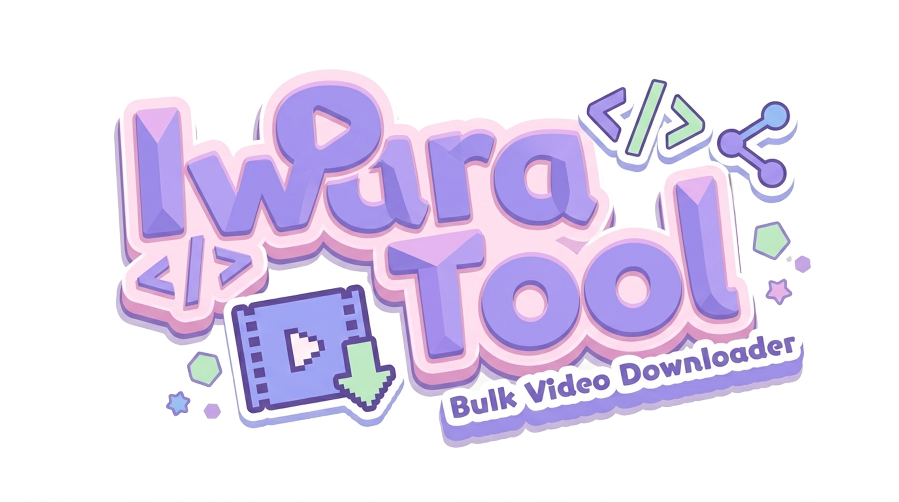
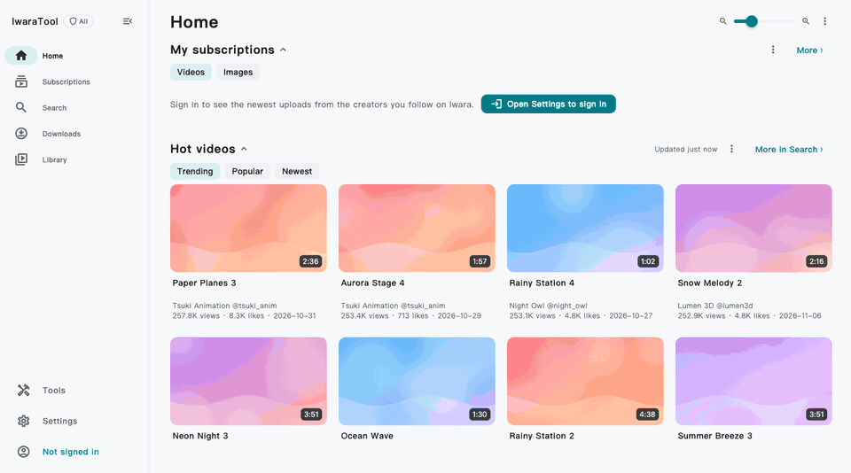

# IwaraTool

  
  
  
   
  
  
  
  
  
  
  
  
   
  
  
  

[English](../../readme.md) | [日本語](./readme_ja.md)

告别繁琐的命令行！拥有现代化界面的 Iwara 批量下载器，支持 Windows、macOS 与 Android，小白也能一键下载作者全视频。

## 软件预览

各页面、深色主题与手机布局的截图见 **[软件预览](../preview.md)**。

## 能做什么

- **批量下载**：在“下载”页粘贴作者、播放列表、搜索或视频链接，一次下完。没下完的任务下次打开程序会接着继续；大文件多连接分段下载，中断后按段续传。
- **搜索与浏览**：搜索 Iwara 与 Oreno3D，中日英标签候选；首页可自定义栏目（我的订阅、热门，或任意标签 / 关键词）。已有的视频会有标记。
- **先看再下**：点击封面进入详情页：内置播放器、点赞、作者、标签、相关推荐与评论。
- **iwara.tv 与 iwara.ai**：Ctrl+Shift+S 一键切换浏览的站点，两站共用账号；粘贴的链接和订阅都按各自的站点处理。
- **关注作者**：订阅作者和播放列表，新视频一目了然，只下载新增的部分。
- **能播放的资料库**：已下载的视频以表格 / 列表 / 封面查看，支持筛选、NFO 标签、上一个 / 下一个与自动连播，删除记录可撤销。
- **只下想要的**：下载规则可按点赞、播放、日期、标签和标题关键词筛选，每个页面还能记住各自的规则。
- **按你的习惯命名**：选一个命名预设或直接编辑模板，从菜单插入字段，实时显示最终文件名。
- **下载到 NAS / 服务器**：交给 NAS 上的 aria2 下载；资料库标为“远端”而不会当成本机文件，封面缓存在本机，填写挂载目录或 HTTP 地址即可播放。
- **整理已有文件**：修复中心以分步流程批量重命名或重新整理已下载的视频，执行前可预览。
- **上传前的准备**：上传压缩可把视频压到 Iwara 的 300 / 600MB 上限以内（H.264 + AAC、MP4、不低于 720p），封面预览提前展示上传后可选的 16 张封面。需要本机装有 ffmpeg。
- **适配各种窗口**：宽窗口为侧栏，窄窗口与手机为抽屉和底栏；中 / 英 / 日界面，深浅色主题，系统通知，Windows 托盘 / macOS 程序坞常驻，开机自启与备份。
- **Android**：在手机上浏览、搜索、订阅、下载与播放；新版 APK 可直接覆盖安装升级。

## 快速开始

1. 从 [Releases](https://github.com/Moeary/IwaraTool/releases) 下载最新版本并运行。（如何选择版本、macOS 首次启动被拦截怎么办、代理怎么填，见 [安装与上手](../guide/install.md)。）
2. 需要下载私有视频或导入关注作者时，点侧栏底部的账号入口登录。
3. 在 `下载` 页粘贴链接并点“下载”，弹出的面板会列出将要加入的内容和使用的规则。
4. 在 `订阅` 页关注作者或播放列表并下载新增内容；下载好的视频在 `资料库` 中查看。

更多：[安装与上手](../guide/install.md) · [使用指南](../guide/usage.md) · [参考文档（支持的链接、命名占位符、从源码构建）](../guide/reference.md) · [本地数据与缓存](../guide/data.md) · [Wiki](https://github.com/Moeary/IwaraTool/wiki)

## 参与贡献

非常欢迎大家提 PR！
请将改动提交到 `dev` 分支，保持英文、简体中文和日文界面文本同步，并在提交前运行完整测试（构建与测试命令见 [参考文档](../guide/reference.md#从源码运行--构建)）。涉及界面变化时，建议附上截图或短视频。

## 代码签名策略（Code signing policy）

发布版本由 GitHub Actions 从本仓库构建。新版 Windows 构建的 SignPath 签名正在接入，启用后每个版本经人工批准才签名。Free code signing provided by [SignPath.io](https://about.signpath.io/), certificate by [SignPath Foundation](https://signpath.org/)。团队角色与隐私政策见英文说明的 [Code signing policy](../../readme.md#code-signing-policy)。

## 许可证

MIT License。

**下载本程序即视为同意遵守 MIT 许可证。详情请参阅 LICENSE 文件。**

1. 禁止将本项目用于任何违法、违规或违背公共秩序与善良风俗的用途；如因违规使用导致损失，责任由用户自行承担。
2. 项目提供的打包版本及脚本仅供个人学习与研究使用，未经许可不得用于商业再发行或转售。
3. 项目维护者保留依据法律法规或社区反馈随时更新、暂停或终止服务与支持的权利。

## 特别感谢

感谢[hare1039](https://github.com/hare1039)的[iwara-dl](https://github.com/hare1039/iwara-dl/tree/master)项目提供的宝贵参考和启发，尤其是在 X-Version 签名计算和下载链接解析方面的实现细节，对本项目的开发起到了重要的推动作用。
