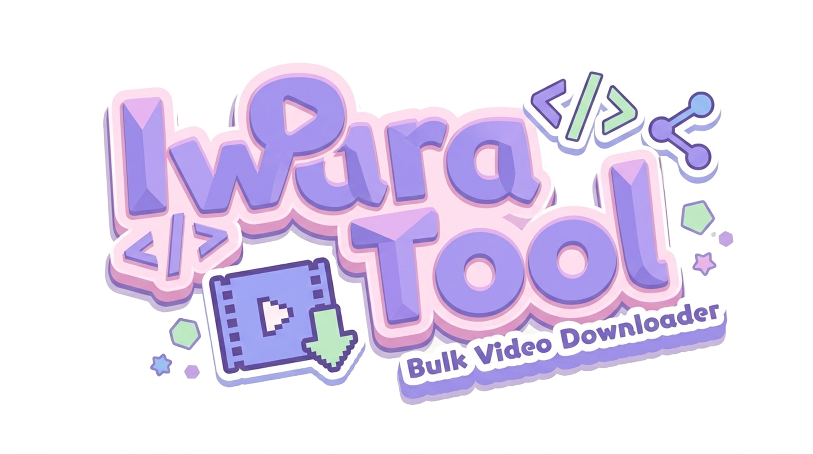
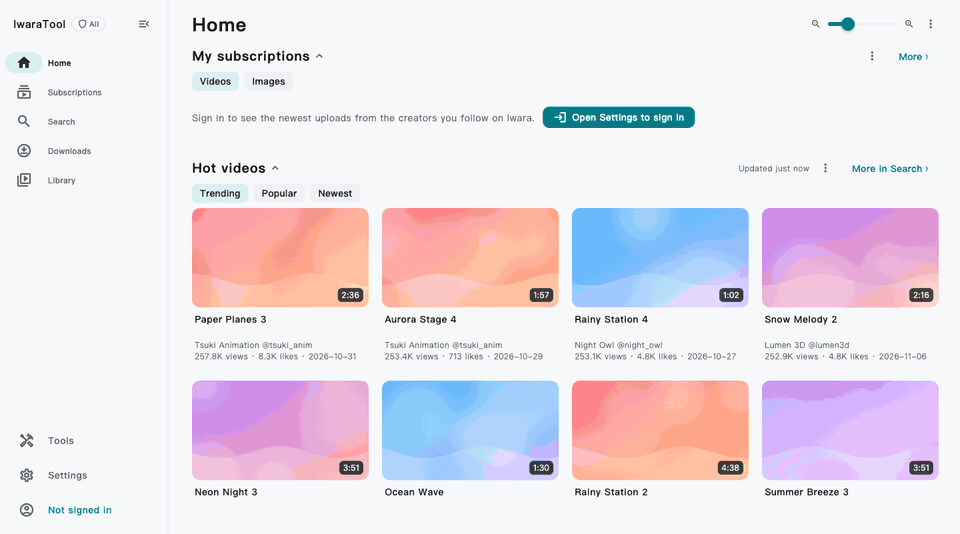

# IwaraTool

  
  
  
   
  
  
  
  
  
  
  
  
   
  
  
  

[简体中文](./docs/readme/readme_zh.md) | [日本語](./docs/readme/readme_ja.md)

Say goodbye to tedious command-line tools! An Iwara batch downloader with a modern interface for Windows, macOS and Android, so anyone can download all of a creator's videos with one click.

## Preview

Every page, the dark theme and the phone layout as still screenshots: **[Screenshots](./docs/preview.md)**

## What you can do

- **Download in bulk**: paste creator, playlist, search or video links on the Downloads page and download everything in one go. Unfinished tasks pick up again the next time you open the app, and large files download over several connections and resume part by part.
- **Search and browse**: search Iwara and Oreno3D, get tag suggestions in Chinese, English and Japanese, and build a Home page of your own rows (your subscriptions, hot lists, any tag or keyword). Videos you already have are marked.
- **Watch before you download**: click a cover to open its page with the built-in player, likes, the author, tags, related posts and comments.
- **iwara.tv and iwara.ai**: switch the site you browse with Ctrl+Shift+S; both share one account, and pasted links and subscriptions always use their own site.
- **Follow creators**: subscribe to authors and playlists, see new videos at a glance, and download only what's new.
- **A library that plays**: every downloaded video in a table, list or cover view with filters, NFO tags, previous / next and autoplay; deletions can be undone.
- **Download only what you want**: rules filter by likes, views, date, tags and title keywords, and each page can remember its own rule.
- **Name files your way**: pick a naming preset or edit the template, insert fields from a menu and see the resulting file name live.
- **Save to a NAS or server**: hand downloads to aria2 running on your NAS; the library marks them "On NAS" (never as local files), covers stay cached here, and a mounted folder or HTTP address lets you play them.
- **Tidy existing files**: the Repair Center renames or reorganizes downloaded videos in a step-by-step flow with a preview.
- **Get ready to upload**: the upload compressor fits a video under Iwara's 300 / 600 MB limit (H.264 + AAC, MP4, at least 720p) and the cover preview shows the 16 cover choices Iwara will offer. Needs ffmpeg.
- **Fits every window**: a sidebar on wide windows, a navigation drawer and bottom bar on narrow ones and phones; Chinese / English / Japanese, light and dark themes, system notifications, a tray icon (Windows) or Dock (macOS), launch at login and backups.
- **Android**: browse, search, subscribe, download and play on your phone; new APKs install over the old one as an update.

## Quick Start

1. Download the latest version from [Releases](https://github.com/Moeary/IwaraTool/releases) and run it. (Which file to pick, the macOS first-launch prompt and proxy setup: see [Installation and First Steps](./docs/guide/install_en.md).)
2. Sign in from the account entry at the foot of the sidebar if you want private videos or the authors you follow.
3. Paste a link on `Downloads` and click Download; a sheet shows what will be queued and with which rule.
4. Use `Subscriptions` to follow authors or playlists and download what's new; downloaded videos appear in `Library`.

More: [Installation](./docs/guide/install_en.md) · [Usage Guide](./docs/guide/usage_en.md) · [Reference (supported links, naming placeholders, build from source)](./docs/guide/reference_en.md) · [Local Data and Caches](./docs/guide/data_en.md) · [Wiki](https://github.com/Moeary/IwaraTool/wiki)

## Contributing

Pull Requests are very welcome!
Please target the `dev` branch, keep English/Simplified Chinese/Japanese UI text in sync, and run the test suite before submitting (build and test commands: [Reference](./docs/guide/reference_en.md#run--build-from-source)). UI changes should include a screenshot or short recording when practical.

## Code signing policy

Releases are built from this repository by GitHub Actions ([build.yml](.github/workflows/build.yml)). Windows code signing through SignPath is being set up for the new build; once active, a release is signed only after it is approved by hand.

Free code signing provided by [SignPath.io](https://about.signpath.io/), certificate by [SignPath Foundation](https://signpath.org/).

- Committers and reviewers: [Moeary](https://github.com/Moeary)
- Approvers: [Moeary](https://github.com/Moeary)

Every change from an outside contributor is reviewed before it is merged, and every signing request is approved by hand.

### Privacy policy

This program will not transfer any information to other networked systems unless specifically requested by the user or the person installing or operating it. It talks only to the services needed for what the user asks:

- iwara.tv (`www`, `api`, `apiq`, `i` and the file servers it returns) to browse, search, sign in and download; the account and password are sent only to Iwara when the user signs in.
- oreno3d.com, when the user searches through the Oreno3D bridge.
- GitHub (`api.github.com`, `raw.githubusercontent.com`) to check for a new release and to fetch the tag dictionary; the release check can be turned off in Settings.
- A proxy or a local aria2 RPC server, only when the user configures one.

Settings, history and caches stay in the `data` folder next to the program (macOS: `~/Library/Application Support/IwaraTool`; Android: the app's own storage).

## License

MIT License.

**By downloading this program, you agree to comply with the MIT License. See the LICENSE file for details.**

1. Using this project for any illegal, regulatory-violating purpose or any purpose against public order and good morals is prohibited; the user bears full responsibility for losses caused by non-compliant use.
2. The packaged versions and scripts provided by the project are for personal learning and research only, and may not be used for commercial redistribution or resale without permission.
3. Project maintainers reserve the right to update, suspend, or terminate services and support at any time in accordance with laws and regulations or community feedback.

## Special Thanks

Thanks to [hare1039](https://github.com/hare1039)'s [iwara-dl](https://github.com/hare1039/iwara-dl/tree/master) project for its valuable reference and inspiration, especially in the implementation details of X-Version signature calculation and download link parsing, which played a key role in the development of this project.
