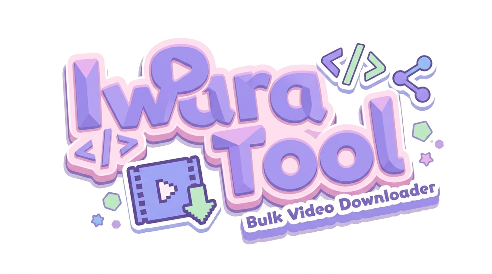
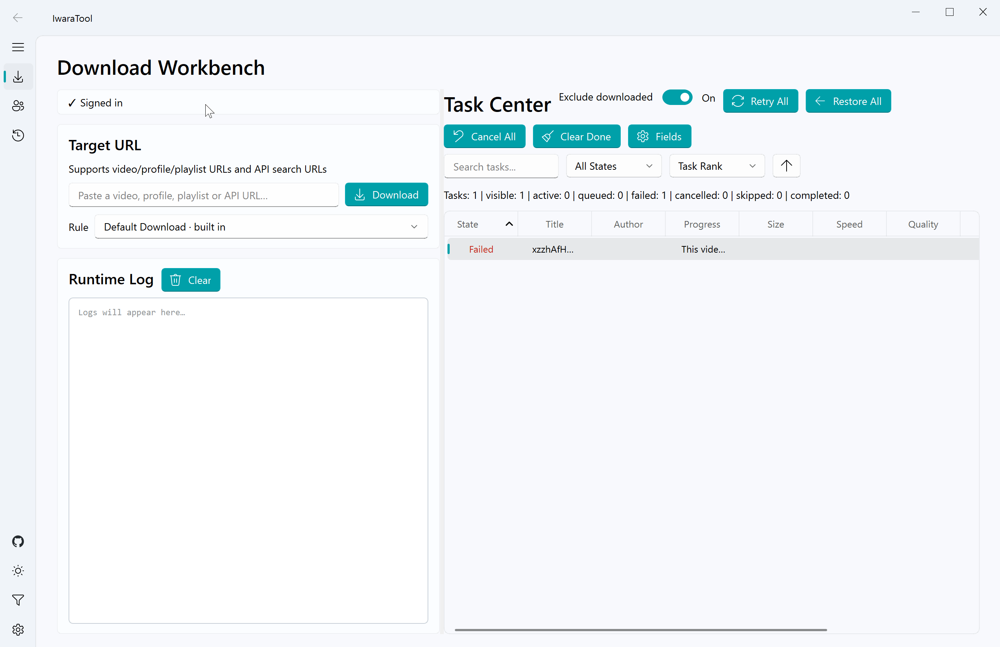
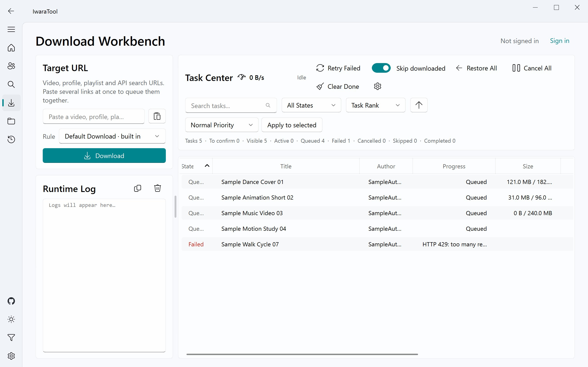
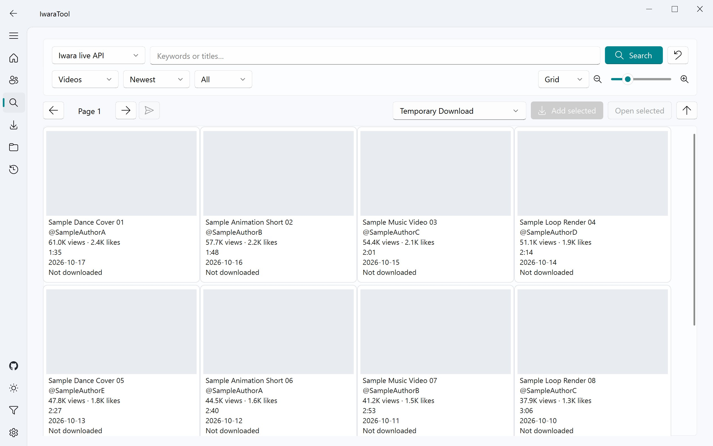
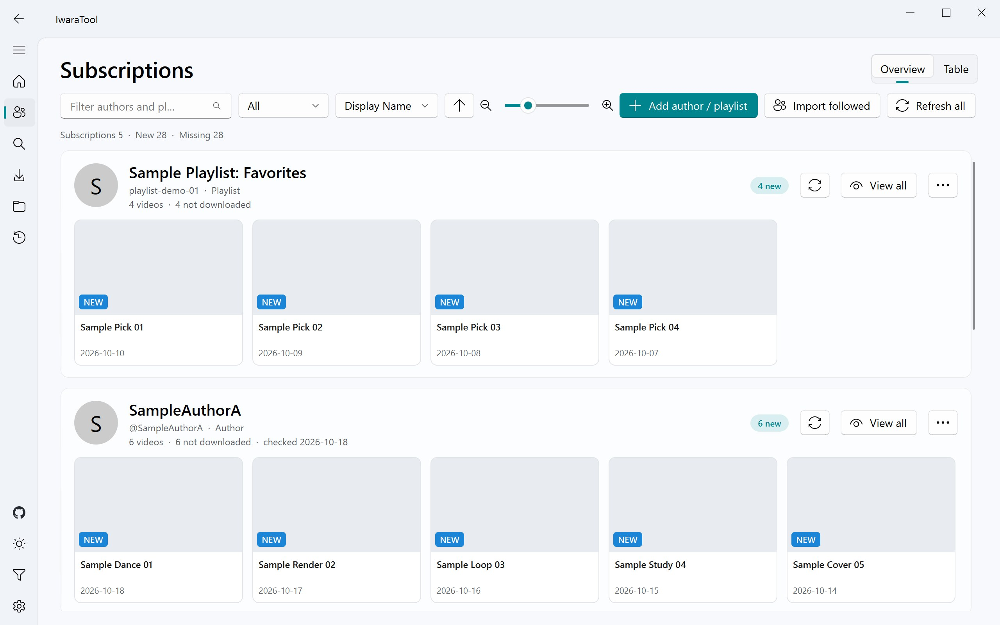
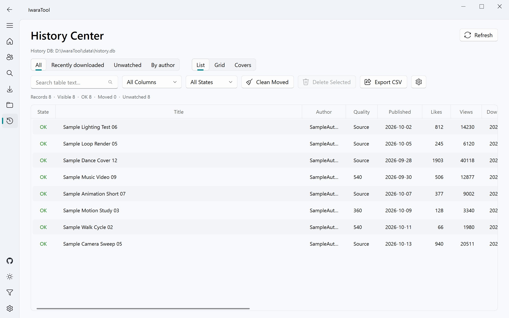
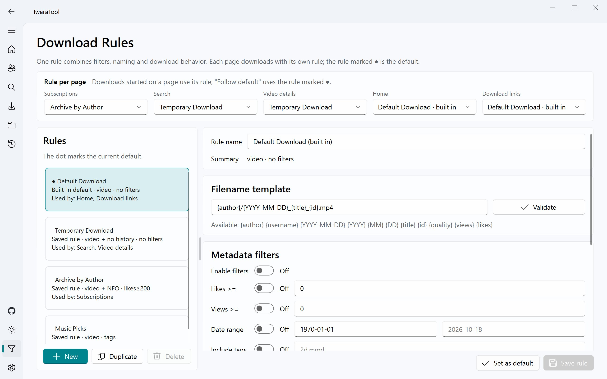
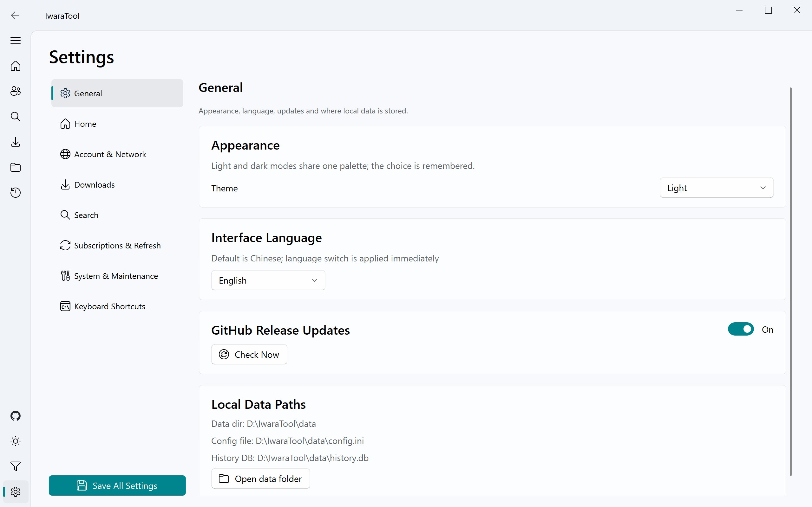

# IwaraTool

[English](./readme.md) | [简体中文](./readme_zh.md)

煩わしいコマンドラインにさよなら！モダンな Fluent スタイルのインターフェースを備えた Iwara 一括ダウンローダー。初心者でもワンクリックで作者の全動画をダウンロードできます。

## できること

- **一括ダウンロード**：作者・プレイリスト・検索・動画の URL を貼り付けるだけでまとめて保存。終わらなかったタスクは、次回起動時に続きから再開します。
- **検索と閲覧**：Iwara と Oreno3D を検索でき、英中日のタグ候補にも対応。ホームには好きな欄（購読、人気、任意のタグやキーワード）を並べられます。保存済みの動画には印が付きます。
- **作者をフォロー**：作者とプレイリストを購読し、新着をひと目で確認。新しい動画だけをダウンロードできます。
- **見てから保存**：動画をダブルクリックすれば、アプリ内でそのまま再生できます。
- **欲しいものだけ保存**：保存ルールで、いいね数・再生数・日付・タグ・タイトルのキーワードによる絞り込みができ、ページごとに別のルールも使えます。
- **好みの名前で保存**：命名プリセットを選ぶか、フィールド（作者・タイトル・ID・日付・画質…）とその間の文字を選んで組み立てられます。結果はリアルタイムでプレビュー。
- **既存ファイルを整理**：修復センターで、保存済みの動画を一括リネームしたり整理し直したりできます。
- **記録と管理**：検索・絞り込みできる履歴、重複検出、任意のカバー画像とメディアライブラリ向けの `.nfo` ファイル。
- **使い心地**：中／英／日の言語、ライト／ダークテーマ、システムトレイ。Windows ではログイン時の自動起動、バックアップ、ワンクリック更新に対応。

## 画面紹介

1. ダウンロードワークベンチ

   
2. 検索

   
3. 購読

   
4. 履歴

   
5. ルール

   
6. 設定

   

## クイックスタート

1. [Releases](https://github.com/Moeary/IwaraTool/releases) から最新版を取得して起動します。（Linux と macOS の注意は [リファレンス](./docs/guide/reference_ja.md#プラットフォームの注意) を参照。）
2. 非公開動画の保存やフォロー作者の取込にはログインが必要です。
3. `ダウンロードワークベンチ` に URL を貼り付け、必要に応じてルールを選択して送信します。
4. `購読` で作者やプレイリストをフォローし、新着動画を保存できます。

詳細：[使用ガイド](./docs/guide/usage_ja.md) · [リファレンス（対応 URL、命名プレースホルダー、ソースからのビルド）](./docs/guide/reference_ja.md) · [ローカルデータとキャッシュ](./docs/guide/data_ja.md) · [Wiki](https://github.com/Moeary/IwaraTool/wiki)

## 貢献

PRは大歓迎です！
変更は `dev` ブランチ向けに提出し、英語、簡体字中国語、日本語の UI 文言を同期してください。提出前にテスト一式を実行し（ビルドとテストのコマンドは [リファレンス](./docs/guide/reference_ja.md#ソースから実行--ビルド) を参照）、UI の変更には可能であればスクリーンショットまたは短い録画を添付してください。

## コード署名ポリシー（Code signing policy）

Windows 版は GitHub Actions が本リポジトリからビルドし、リリースを手動で承認してから署名します。Free code signing provided by [SignPath.io](https://about.signpath.io/), certificate by [SignPath Foundation](https://signpath.org/)。チームの役割とプライバシーポリシーは英語版の [Code signing policy](readme.md#code-signing-policy) を参照してください。

## ライセンス

MIT License。

**本プログラムをダウンロードした時点で、MIT ライセンスを遵守することに同意したものとみなされます。詳細は LICENSE ファイルを参照してください。**

1. 本プロジェクトを違法、公序良俗に反する目的、または法令に違反する目的で使用することを禁止します。違反した使用により生じた損害については、ユーザーが全責任を負うものとします。
2. 本プロジェクトで提供されるパッケージ版およびスクリプトは、個人の学習および研究目的のみに使用されるものであり、許可なく商用での再配布や転売を行うことはできません。
3. プロジェクトの管理者は、法令またはコミュニティのフィードバックに基づき、いつでもサービスおよびサポートを更新、中断、または終了する権利を留保します。

## 特別感謝

[hare1039](https://github.com/hare1039) 氏の [iwara-dl](https://github.com/hare1039/iwara-dl/tree/master) プロジェクトから貴重な参考とインスピレーションをいただきました。特に X-Version 署名計算とダウンロードリンク解析の実装詳細は、本プロジェクトの開発に大きな推進力となりました。
