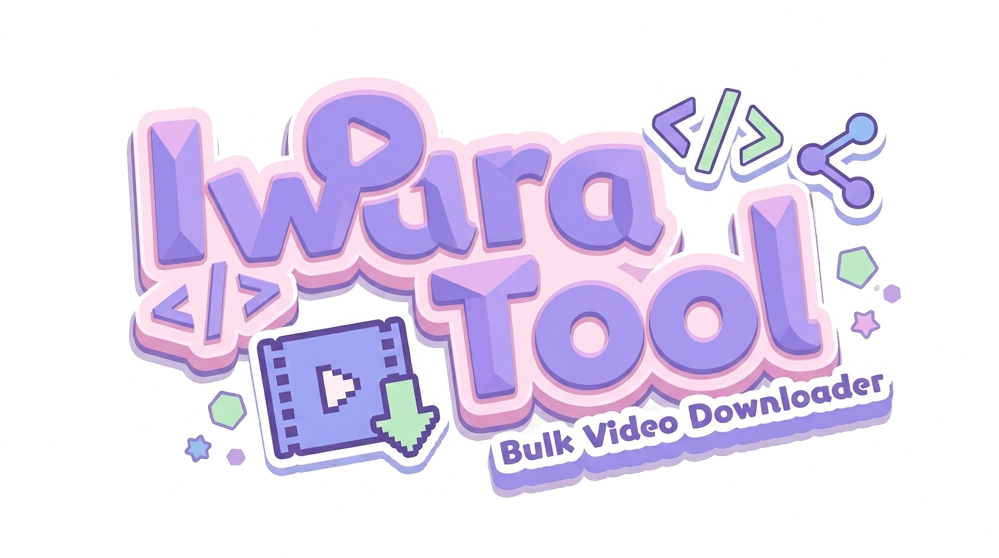
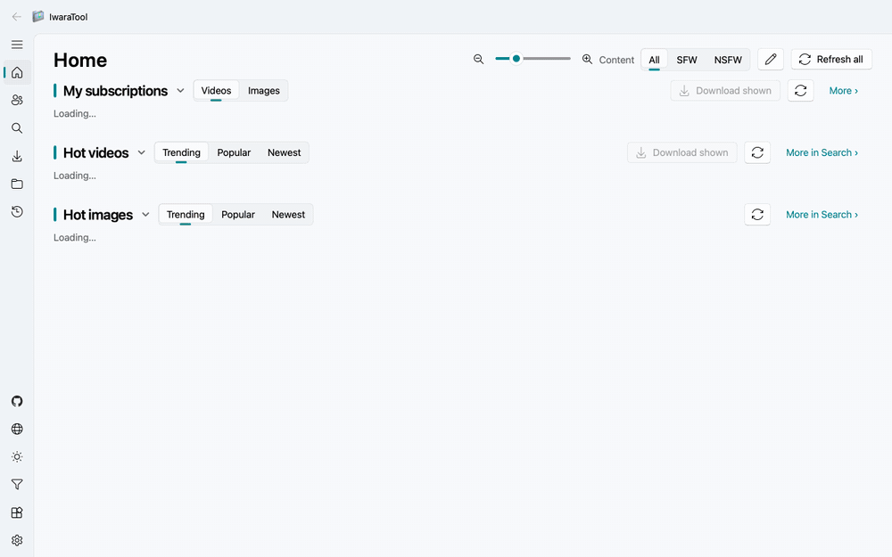
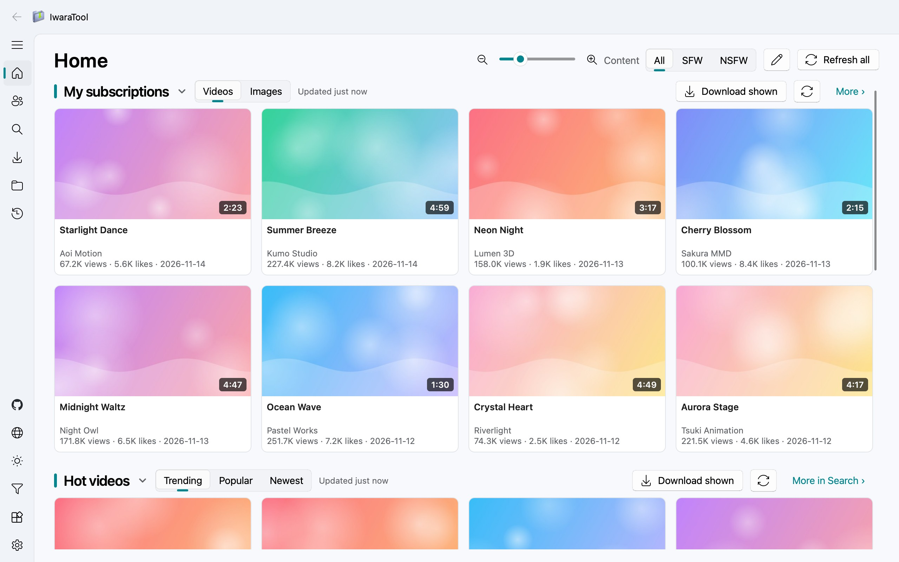
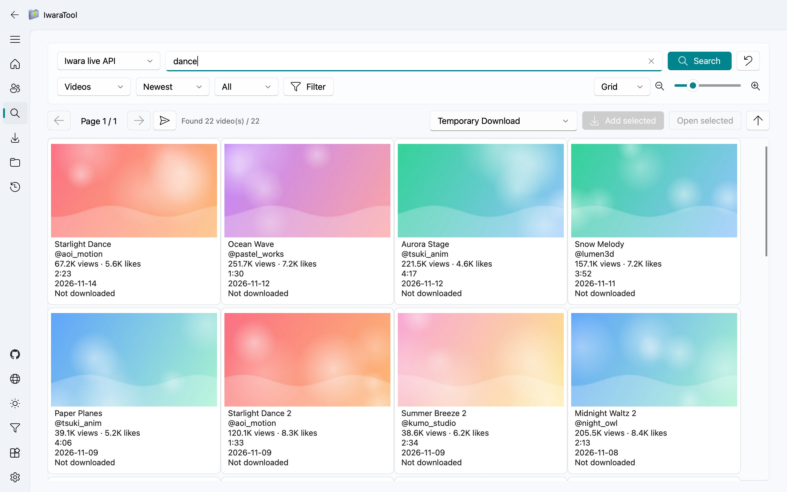
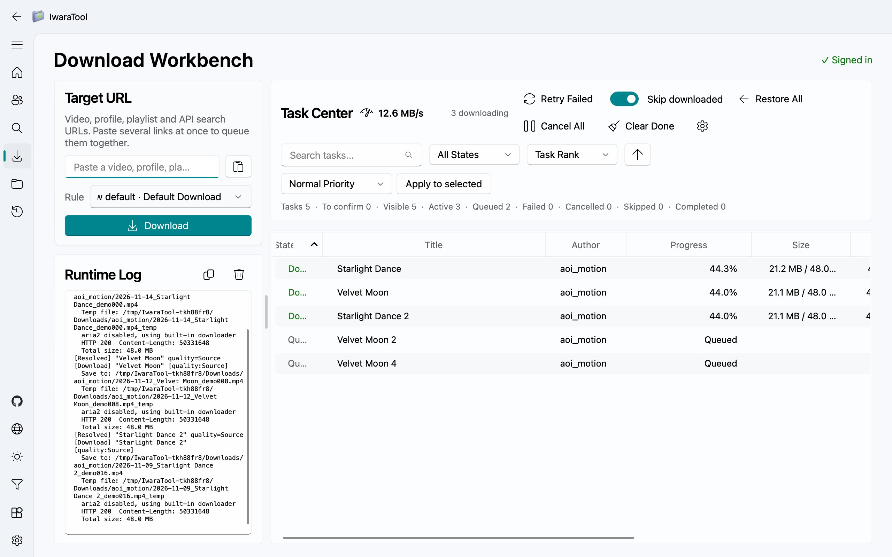
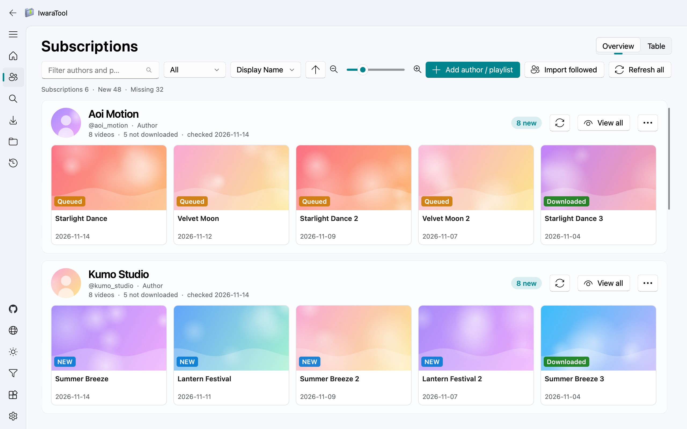
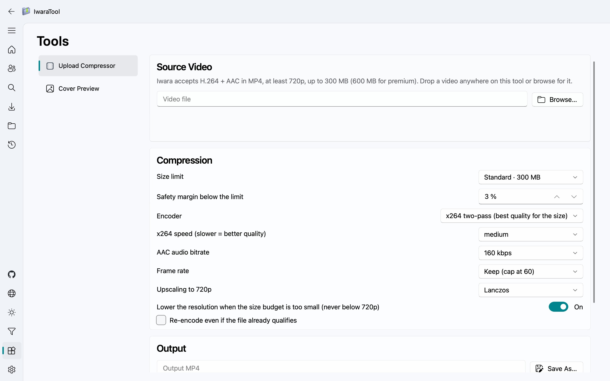
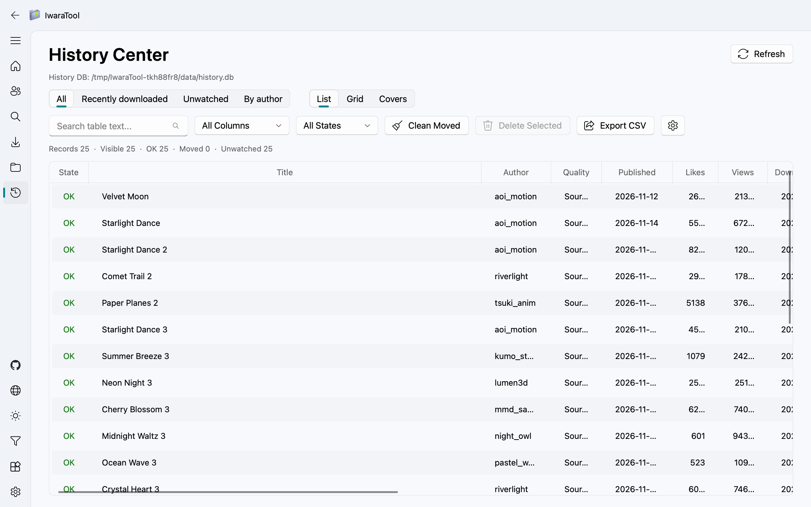
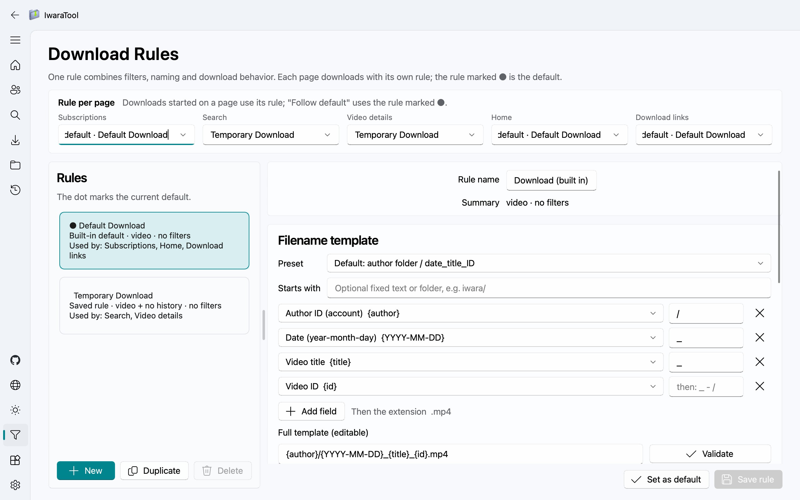
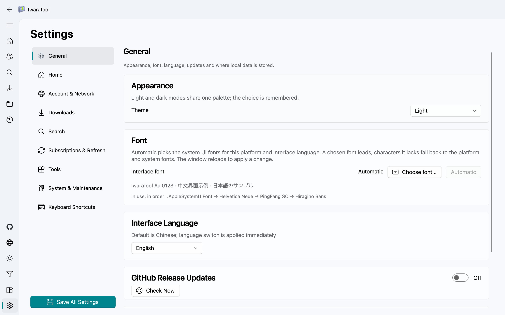

# IwaraTool

[English](./readme.md) | [日本語](./readme_ja.md)

告别繁琐的命令行！拥有现代化 Fluent 风格界面的 Iwara 批量下载器，小白也能一键下载作者全视频。

## 能做什么

- **批量下载**：粘贴作者、播放列表、搜索或视频链接，一次下完。没下完的任务，下次打开程序会接着继续。
- **搜索与浏览**：搜索 Iwara 与 Oreno3D，中日英标签候选；首页可自定义栏目（我的订阅、热门，或任意标签 / 关键词）。已有的视频会有标记。
- **iwara.tv 与 iwara.ai**：侧栏或 Ctrl+Shift+S 一键切换浏览的站点，两站共用账号；粘贴的链接和订阅都按各自的站点处理。
- **关注作者**：订阅作者和播放列表，新视频一目了然，只下载新增的部分。
- **先看再下**：双击任意视频即可在程序里直接播放。
- **只下想要的**：下载规则可按点赞、播放、日期、标签和标题关键词筛选，每个页面还能使用各自的规则。
- **按你的习惯命名**：选一个命名预设，或逐个选字段（作者、标题、ID、日期、画质……）并填写它们之间的连接符来拼出命名规则，并带实时预览。
- **整理已有文件**：修复中心可批量重命名或重新整理已下载的视频。
- **上传前的准备**：工具页可把视频压到 Iwara 的 300 / 600MB 上传上限以内（H.264 + AAC、MP4、不低于 720p），并提前预览上传后可选的 16 张封面。需要本机装有 ffmpeg。
- **留痕与管理**：带搜索筛选的下载历史、重复检测，可选封面图与供媒体库使用的 `.nfo` 文件。
- **用着顺手**：中 / 英 / 日界面，深浅色主题，系统托盘，Windows 下支持开机自启、备份与一键更新。

## 页面展示

截图均为英文界面与虚构的示例数据，封面是生成的占位图；`scripts/record_demo.py` 可离线重新录制 GIF 与这些截图。

1. 首页

   
2. 搜索页

   
3. 下载工作台

   
4. 订阅页

   
5. 工具页（上传压缩与封面预览）

   
6. 历史记录页

   
7. 规则页

   
8. 设置页

   

## 快速开始

1. 从 [Releases](https://github.com/Moeary/IwaraTool/releases) 下载最新版本并运行。（如何选择版本、macOS 首次启动被拦截怎么办、代理怎么填，见 [安装与上手](./docs/guide/install.md)。）
2. 需要下载私有视频或导入关注作者时，请先登录。
3. 在 `下载工作台` 粘贴链接，按需选择下载规则后提交。
4. 在 `订阅页` 关注作者或播放列表，并下载新增内容。

更多：[安装与上手](./docs/guide/install.md) · [使用指南](./docs/guide/usage.md) · [参考文档（支持的链接、命名占位符、从源码构建）](./docs/guide/reference.md) · [本地数据与缓存](./docs/guide/data.md) · [Wiki](https://github.com/Moeary/IwaraTool/wiki)

## 参与贡献

非常欢迎大家提 PR！
请将改动提交到 `dev` 分支，保持英文、简体中文和日文界面文本同步，并在提交前运行完整测试（构建与测试命令见 [参考文档](./docs/guide/reference.md#从源码运行--构建)）。涉及界面变化时，建议附上截图或短视频。

## 代码签名策略（Code signing policy）

Windows 版本由 GitHub Actions 从本仓库构建，发布经人工批准后才签名。Free code signing provided by [SignPath.io](https://about.signpath.io/), certificate by [SignPath Foundation](https://signpath.org/)。团队角色与隐私政策见英文说明的 [Code signing policy](readme.md#code-signing-policy)。

## 许可证

MIT License。

**下载本程序即视为同意遵守 MIT 许可证。详情请参阅 LICENSE 文件。**

1. 禁止将本项目用于任何违法、违规或违背公共秩序与善良风俗的用途；如因违规使用导致损失，责任由用户自行承担。
2. 项目提供的打包版本及脚本仅供个人学习与研究使用，未经许可不得用于商业再发行或转售。
3. 项目维护者保留依据法律法规或社区反馈随时更新、暂停或终止服务与支持的权利。

## 特别感谢

感谢[hare1039](https://github.com/hare1039)的[iwara-dl](https://github.com/hare1039/iwara-dl/tree/master)项目提供的宝贵参考和启发，尤其是在 X-Version 签名计算和下载链接解析方面的实现细节，对本项目的开发起到了重要的推动作用。
